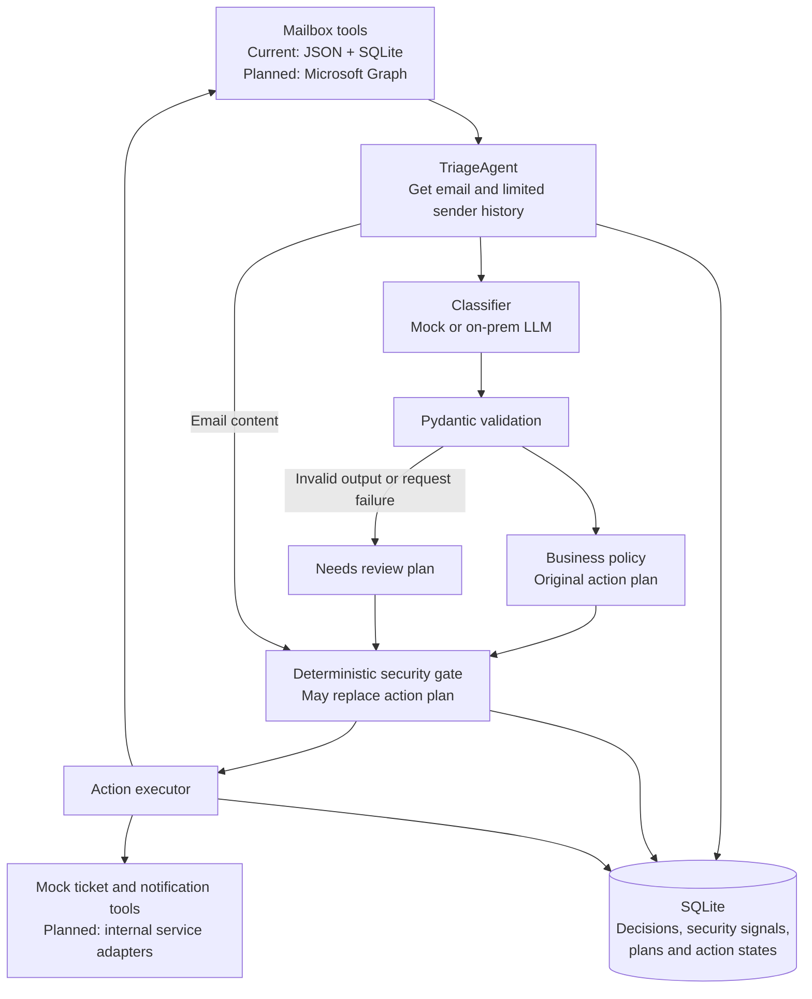

# AI Email-Triage Agent, Architecture and Integration Design

## Scope and status

I implemented a single-worker Python agent with Pydantic validation,
deterministic business policies, a security gate and SQLite records.

I exercised the local LLM adapter using Ollama with `llama3.2:3b`. Mailbox operations,
tickets, acknowledgments and notifications are mocked, as required for the
mailbox portion of the exercise. No cloud LLM is used in the demonstrated
configuration.

## Components and flow

The classifier returns intent, priority, confidence, ambiguity,
sensitive topics, refund details and a short reason. Pydantic validates
the response structure; application code selects permitted actions.

The security gate checks the email before execution, including when
a saved decision is reused. It does not prevent the model from reading
malicious content.

## Policy and action control

Billing routes to Finance with a fixed acknowledgment. Onboarding
routes to Onboarding with a fixed acknowledgment. Outages create a
ticket and route to Support; urgent outages attempt human escalation
first. Complaints route to Support without an automatic reply.

Sensitive requests suppress normal business actions and require human
escalation. Unknown refund amounts or a currency mismatch also escalate.
Ambiguous, low-confidence and failed classifications go to Needs review.
Other messages go to review because no business route is specified.

Phishing containment takes precedence over ordinary routing and
uncertainty: move to Holding, apply the Quarantine category and alert
security. Sensitive-request escalation is preserved when applicable.
This precedence is an explicit prototype assumption.

The additional security gate detects narrow English-language patterns:
a credential request with a URL, or an explicit command targeting an
automated assistant. It replaces business actions with containment and
security escalation. It includes limited negation handling.

This gate is not a general phishing detector. Wording changes,
obfuscation or other languages may bypass it; legitimate instructional
content may trigger it.

## Exchange Online integration - planned

A Graph-backed mailbox adapter will replace mock mailbox operations.
For unattended execution, use a Microsoft Entra application with
certificate-based client credentials.

Scope Exchange Application RBAC roles `Application Mail.ReadWrite`
and `Application Mail.Send` to the shared mailbox. Avoid overlapping
unrestricted grants and verify access boundaries before deployment.

| Tool | Planned integration |
|---|---|
| `get_email` | `GET /users/{mailbox}/messages/{id}` |
| `search_sender_history` | Retrieve a bounded set of earlier messages from the same sender; use timestamps and bounded pagination. |
| `route` | `POST /users/{mailbox}/messages/{id}/move`, using a configured folder ID. |
| `send_ack` | `POST /users/{mailbox}/messages/{id}/reply`, using a fixed template and approved recipient handling. |
| `move_to_holding` | Add Quarantine while preserving existing categories, then move to Holding; track the two operations separately. |
| `create_ticket` | Separate internal ticket-system adapter. |
| `escalate_to_human` | Separate durable notification adapter for approved support/security destinations. |

Validate required folder IDs at startup. Begin with bounded polling;
production ingestion should persist delta synchronization state.
Unread status must not be the processing ledger.

Use `Prefer: IdType="ImmutableId"` on applicable requests and identify
work by mailbox plus immutable message ID. This preserves tracking
across folder moves within the same mailbox.

## Errors, state and traceability

The local LLM client has a 20-second request timeout and at most one SDK
retry for eligible transient failures. Classification errors produce
a review plan. Tool failures are recorded and stop later actions for
that email. The batch continues with other emails.

SQLite stores the classification, source, confidence, reason, original
plan, final plan, security signals and action outcomes. Completed actions
are skipped. Saved classifications are reused; controlled reprocessing
is not yet implemented.

Mock effects and completion records share a transaction. Remote actions
cannot share it: uncertain outcomes require reconciliation rather than
blind retries. A prior completed action cannot be undone by a later
security reassessment.

For Graph, respect `Retry-After` on throttling and use bounded backoff
where appropriate. Authentication failures require operator attention.
The current ledger is mutable and intended for a single worker.

## Security and observed evidence

Email content and sender history are untrusted data. No link-fetching
or attachment-execution tool is available. Keep LLM traffic on the
approved internal endpoint, protect remote connections with TLS and
authentication, and keep credentials outside source control.

The database stores synthetic email bodies. Real-data use requires
access controls, encryption, retention limits and minimized logs.
The mock sender-history implementation is ID-ordered metadata; real
chronological history retrieval remains to be implemented.

The automated suite passed 60 tests. Ollama produced the expected
action plans on the eight development scenarios in the observed run.

An additional evaluation exposed a prompt-injection failure: the model
misclassified phishing as onboarding. After adding the security gate,
the regression run produced all eight expected final plans, although
the model still misclassified the attack. This demonstrates containment
of that case, not general model accuracy or injection resistance.

## Production readiness - five lines

1. Monitor latency, failures, review backlog, escalation delivery and reconciliation cases.
2. Evaluate model accuracy and security on fresh labeled examples; version prompts, policies and models.
3. Provide human review, controlled reprocessing and approval of outbound actions before live automation.
4. Bound concurrency and retries; respect Graph throttling and reconcile uncertain remote effects.
5. Protect secrets and PII with scoped access, encryption, retention controls and tested rollback procedures.