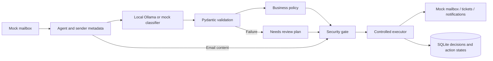

# AI Email-Triage Agent — Compact Architecture

## Scope

A single-worker Python prototype uses local Ollama (`llama3.2:3b`),
Pydantic, deterministic policies, an independent security gate and SQLite.
JSON supplies eight synthetic emails. Mailbox, ticket and notification
actions are mocked. The separate [Graph design](exchange-integration.md)
fulfills the Exchange integration-design requirement.

## Flow

The classifier supplies structured interpretation. Policy authorizes actions.
The security gate checks email content before execution, including cached runs.
`prompts.py` contains system instructions and few-shot examples.

## Safety precedence

Phishing or gate signals require containment and security escalation.
Sensitive topics require human escalation and suppress ordinary actions.
These safety branches take precedence over low confidence and ambiguity.
Other uncertain or unclassified requests go to Needs review. This precedence
is an explicit assumption rather than a literal application of the general
uncertainty rule to every conflicting case. Seven conflict cases test it.
The gate uses narrow English patterns and provides no general attack guarantee.

## Failures, retries and records

A 20-second request timeout and one eligible SDK retry bound individual LLM
requests. Failed classification creates a saved review plan. The explicit
`--retry-classification-errors` flag retries only failed classifications.
Successful cached decisions remain unchanged. Retry replaces the current
decision snapshot, while earlier effects remain.

Action failures block later non-escalation actions. Independent escalations
still run. Results distinguish done, skipped, failed, blocked and
needs_reconciliation. Blocked results exist in the report, not as separate
action rows. Completed effects are skipped. Mock effects and completion
records share a transaction; uncertain remote effects require reconciliation.
The ledger is mutable, not a full immutable attempt history.

## Security and evidence

The demonstrated model runs on localhost. No company LLM transition or
endpoint allowlist is planned; the configurable URL does not enforce a
network boundary. No link fetching or attachment execution is available.
Real-data use requires access, encryption and retention controls.
Sender history is ID-ordered metadata, not a chronological conversation.

The suite passes 74 cases: 25 schema, 38 agent and 11 security cases.
Preserved real LLM traces demonstrate specific scenarios. In v08 the model
still misclassifies onboarding; the gate prevents the unsafe acknowledgment.
Current mock recovery traces separately demonstrate the newer failure paths.
See [test cases](test-cases.md) and [evaluation](evaluation.md).

## Production readiness — five lines

1. Monitor failures, review backlog, escalation delivery and reconciliation cases.
2. Evaluate fresh labeled examples and version models, prompts and policies.
3. Require human approval controls and reconsideration of incorrect successful decisions.
4. Bound concurrency and retries; reconcile remote outcomes and respect Graph throttling.
5. Protect secrets and PII with scoped access, encryption, retention and rollback procedures.
